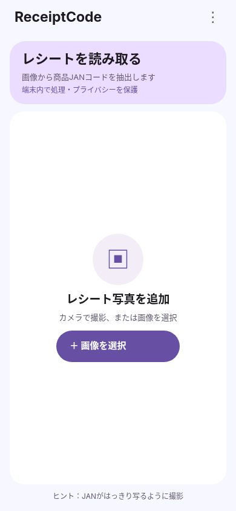
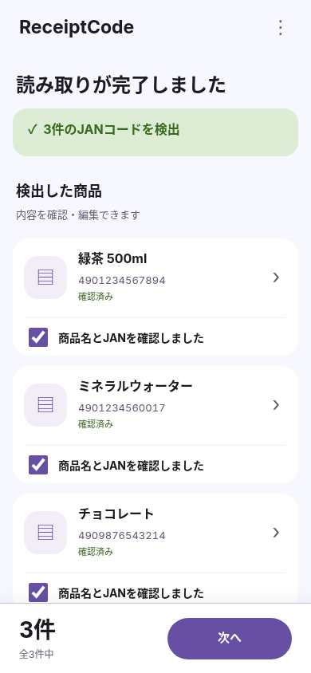
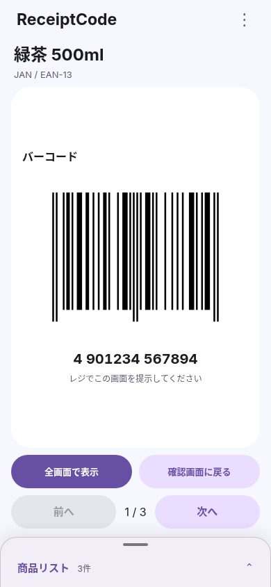
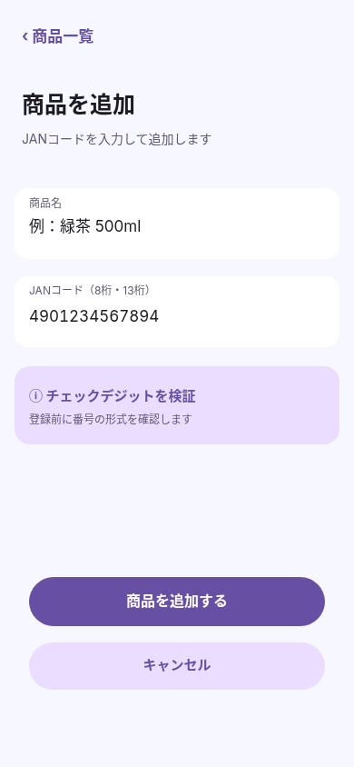

# ReceiptCode Material 3 UI

## デザインの取得

Figma: https://www.figma.com/design/EkLDLqz36f4daWXms8Xton

2026-10-25にFigmaプラグインの `get_design_context` で4フレームのコード・スクリーンショットを取得。前段の `use_figma` 読み取りでは Page 1、4フレーム、Component / Instance 0件、クリック遷移10件を確認した。画像・SVGの静的アセットはなく、アイコンは文字、バーコードは長方形によるモックだった。

## 既存機能と新UIの対応

| Figma画面 | 実装 | 接続する既存機能 |
|---|---|---|
| 01 レシートを選ぶ (`1:2`) | ReceiptUploader | selectImage → 画像準備 → ImagePreview → startOcr。撮影/ファイル選択、手入力開始を維持 |
| 02 読み取り結果 (`1:22`) | ItemList / ItemEditor | 実OCRの商品一覧、検証状態、重複警告、編集、確認、削除、再OCR、一括バーコード表示 |
| 03 バーコード表示 (`1:57`) | BarcodeViewer | 選択商品のJsBarcode SVG、EAN-13/8、前後移動、集中表示、Wake Lock |
| 04 商品を手動追加 (`4:17`) | ManualAddForm（独立画面） | validateJan / addItem。先頭ゼロ保持、8/13桁、チェックデジット検証、有効なら初期チェック済みで追加 |

## 実装上の判断

- React / TypeScript / CSS を継続し、依存を追加しない。色・形状・余白をCSSトークンにする。
- Figmaの390×844の構成を基準に、固定座標をFlex/Gridと最小サイズへ変換。320px、横向き、デスクトップ、文字折り返しに対応する。
- Inter 400/700のローカルWOFF2（SIL Open Font License）を同梱。日本語はNoto Sans CJK JP等へフォールバックする。外部フォントサービスへの実行時通信はない。
- 時刻・電波・電池を模したステータスバーは表示しない。対応する45pxの領域を削除し、アプリのヘッダーから表示する。
- 確認画面で各商品のチェック欄を選び、画面下端に固定した件数と「次へ」から次のフローへ進む。一覧順に「バーコード→次へ→バーコード」と連続表示する。末尾では次へ、先頭では前へが無効になる。
- 商品カード・左アイコンは確認・編集専用。選択件数と「次へ」をスクロール中も固定表示し、前後移動を常時表示して、個別商品のタップからバーコードへ直接遷移しない。未確認・無効JANの除外、再編集での確認解除を維持する。
- Figmaで全商品が同じモックに遷移する部分を、実際の商品に接続。未確認/無効JANのバーコード表示禁止を維持する。
- Figmaのチョコレートの `4909876543218` はチェックデジット不正（期待値4）。画面のデモ値を実データとして流用せず、既存の検証で拒否する。見た目の比較用データには `4909876543214` を使用した。
- Figmaの「全画面で表示」は既存の集中表示に接続し、対応ブラウザではFullscreen APIも利用する。非対応でも集中表示を使える。
- OCR結果・手動追加とも、チェックデジットが有効なJANは初期チェック済み。無効JANは未チェックかつ選択不可。要確認の注記・警告は保持する。編集後はチェックを解除する。
- 入力・削除・重複・画像処理・リソース解放・データ非永続化の仕様は変更しない。追加画面の閉じる/戻るで一覧のデータを保持する。
- プレビュー・処理中・エラー画面は既存機能として残し、共通のMaterial 3スタイルを適用する。
- 色だけに頼らない状態表示、48px以上の操作領域、キーボードフォーカス、reduced-motion、入力エラー関連付けを用意する。

## 検証

- `npm run lint` / `npm run typecheck` / `npm test`（68件）/ `npm run build` が成功。
- ChromiumでE2E 9件（実OCRの代わりに既存の固定OCRエンジン）が成功。本番ビルドの `/receipt2jan/` 配信も確認。
- 追加画面でのキャンセル/戻るによるデータ保持、未確認カードの編集、一覧の「次へ」から確認済み商品を連続表示する遷移、再編集での確認解除をコンポーネントテストに追加。
- 390×844で4画面を撮影し、Figmaのスクリーンショットと比較。主要カードの配色・角丸・余白・操作順を確認。320×568、844×390、1280×900でも横はみ出しなし。
- 主要矩形（説明カード、画像選択、入力欄、成功バナー、商品カード、追加ボタン、バーコードカード等）の位置・寸法をFigma測定値の±1px以内でE2E検証。確認から連続表示へのフローは利用要望に合わせてFigmaから拡張。
- バーコードの線パターンと商品情報・検証状態は実データに従う。番号を13桁なら1/6/6桁、8桁なら4/4桁に分けて表示する。SVGは既存の生成・検証結果を使用し、表示枠に合わせて横・縦を独立に拡縮する（左右のQuiet Zoneを含む）。実機とハンディスキャナーでの確認は未実施。

## 画面の比較資料

390×844のビューポートで実処理に接続したUIを撮影。架空の商品情報のみを使用。Figmaの4画面の構成・寸法・文字サイズ・余白を比較できる。バーコードの線パターンは有効なJANから生成したものを表示している。

| 01 レシート選択 | 02 読み取り結果 |
|---|---|
|  |  |

| 03 バーコード表示 | 04 手動追加 |
|---|---|
|  |  |

## ビューポートへの収容

写真追加・バーコード表示は100dvhの枠でFlex/Gridの可変領域を使い、320×568・390×844・844×390・1280×900でページスクロールなし、主要ボタン・バーコードの全体表示を検証。横向きは左右配置とする。外枠の角丸・固定の844px最小高さ・確認画面下部の白帯を撤去し、背景色を下端まで統一する。商品カード等の内側の角丸と、商品選択シート内のスクロールは保持する。
