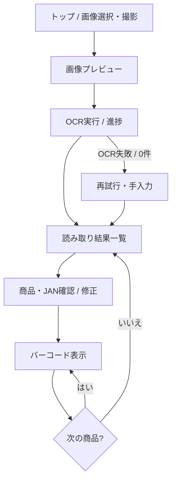
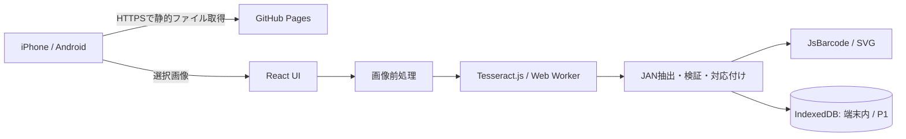

# Receipt2JAN — 設計仕様書

> **用途**: 開発Agentに渡す実装仕様（プロダクト要求 + 技術設計 + 受け入れ基準）  
> **版**: 1.0 / **作成日**: 2026-10-20  
> **対象**: iPhone / Android のブラウザで使う、無料のレシートOCR → JANバーコード生成Webアプリ

---

## 0. 開発Agentへの最重要指示

この文書を **実装上のSingle Source of Truth（唯一の仕様の基準）** として扱うこと。

1. **プロジェクト名は `Receipt2JAN`**。別名に変更しない。
2. **サーバーレス・無料・プライバシー優先**。商品やレシートを共有するバックエンド、認証、DBサーバー、外部OCR APIは作らない。
3. 最優先は **JANを誤って提示しないこと** と **素早く使えること**。見た目のために確認ステップを削らない。
4. 作業は **MVP → 精度向上 → PWA/オフライン** の順。必要な設計余地は残すが、初期実装で複雑化しない。
5. 実装前に依存ライブラリの現行API・互換性・ライセンスを公式資料で確認し、`package-lock.json` などロックファイルをコミットすること。
6. 動作未検証の機能を「動作済み」と記述しない。**スマホ画面のJANを実機スキャナーが読めることは実機テストで初めて確定**する。
7. 本仕様に明記されない細部は、依存が少なく単純な方法を選び、その判断をREADMEまたは実装メモに記録すること。

## 1. 背景・目的

### 1.1 課題

返品時など、商品本体や商品バーコードが手元にないことがある。その場合、レシートに印字されたJAN（商品識別番号）をレジへ手入力する必要があり、時間がかかる。

### 1.2 解決策

スマートフォンでレシートを撮影または画像選択し、印字された商品名とJANをOCRで読み取る。対象商品と番号を確認した後、**EAN-13 / EAN-8規格のバーコード**として画面表示し、レジのハンディスキャナーで読み取る。

### 1.3 運用モデル

- 全員が同じHTTPS URLを開いて使用できる。
- 読み取り処理は各端末のブラウザ内で完結する。
- データ・履歴は各端末にのみ保存。端末間同期なし。
- サーバー処理なし。アカウント不要。
- 公開先は原則GitHub Pages。維持費0円を目標とする。

## 2. スコープ

### 2.1 必須（MVP / P0）

| ID | 要求 | 完了条件 |
|---|---|---|
| FR-01 | レシート画像選択・撮影 | モバイルでファイル選択 / `accept="image/*"` と必要に応じた `capture` に対応 |
| FR-02 | ブラウザ内OCR | OCRを端末内で実行し、進捗・失敗・再試行を示す |
| FR-03 | JAN抽出 | OCRテキストから13桁/8桁候補を抽出 |
| FR-04 | JAN検証 | チェックデジットでEAN-13 / EAN-8の妥当性を判定 |
| FR-05 | 商品名との対応付け | 近接行を利用して商品名を推定。不確実なら明示 |
| FR-06 | 確認・編集 | 商品名とJANの編集・項目削除・手動追加ができる |
| FR-07 | バーコード描画 | 有効な番号をEAN-13 / EAN-8のSVGバーコードに変換 |
| FR-08 | レジ読み取り画面 | バーコードを白地に大きく表示し、前/次の商品へ移動 |
| FR-09 | モバイルUI | iOS Safari・Android Chromeで主要操作ができる |
| FR-10 | エラー安全性 | 不正JANは原則バーコード化できず、理由を明示 |
| FR-11 | 静的配信 | ビルド結果がGitHub Pagesのサブパスで動く |

### 2.2 次段階（P1）

- 画像の回転・台形補正・トリミング・コントラスト補正。
- 数字中心OCRの二段階処理、OCR再試行、行/矩形ベースの対応付け改善。
- 履歴（商品名・JAN・作成日時のみ）をIndexedDBにローカル保存、検索・削除。
- PWAホーム画面追加、アセットのオフラインキャッシュ。
- 端末/スキャナー別のJAN-13読み取り調整ガイド。
- ダークモード（ただしバーコード画面は必ず白背景）。

### 2.3 将来検討（P2）

- OCR精度評価画面、レシートごとの複数画像結合。
- 明確に重複したJAN行の統合候補提示（勝手に削除しない）。
- 共有機能は今回の対象外。導入するなら別途要件合意が必要。

### 2.4 やらないこと（Non-goals）

- 商品マスタへの接続や商品名のネット検索。
- レジ/POSとのAPI連携、実際の返品決済、在庫操作。
- レシート内の個人情報・決済情報の収集、分析、送信。
- 端末をまたぐ履歴共有、ログイン、管理画面。
- JANのない商品の番号をAIが推測・創作すること。
- 使用端末の画面輝度をWebから強制変更すること。

## 3. ユースケースと画面遷移



### 3.1 トップ画面

- プライマリCTA: **「レシートを撮影 / 画像を選択」**。
- 1〜2行の説明: 「レシートからJANを読み取り、レジでスキャンできるバーコードを表示します」。
- 履歴はP1で表示。
- 初回のみ「写真は外部送信しません（ただしアプリ/言語モデルの初回取得には通信が必要）」と説明。

### 3.2 読み取り画面

- 画像サムネイル、処理進捗（準備中 / 認識中 / 整理中）、キャンセル。
- 読み取りに時間がかかる場合でも画面が固まらず、状態を伝える。
- 失敗した際は「画像を撮り直す」「別画像を選ぶ」「JANを手入力」を提示。

### 3.3 読み取り結果画面

- 行ごとに `商品名 / JAN / 検証状態 / 編集 / バーコード表示` を表示。
- 商品名を推定できない場合は「商品名未認識」と表示。
- 有効なチェックデジットでも、OCRによる誤対応の可能性があるため、**初回表示前に内容をユーザーに確認させる**。
- 「JAN候補なし」「不正な番号」「重複候補」は区別して表示。
- 対象商品だけを表示できるよう選択/絞り込みを追加してよい（MVPでは任意）。

### 3.4 バーコード画面（特に重要）

- バーコード領域は **白背景 + 黒いバー**。透過・グラデーション・装飾を使わない。
- **EAN-13 / EAN-8をSVGで描画**し、描画時に番号も明記。
- 左右に十分なQuiet Zone（白い余白）を残す。バーが画面端に接触しない。
- 画面幅に合わせて拡大縮小。ただし比率・余白を崩して無理に引き伸ばさない。
- 商品名、JAN数字、現在の商品番号 `2 / 10`、**「前へ」「次へ」「一覧に戻る」**。
- モバイルでスキャナーが読みやすいよう、タップ後に不要なナビゲーションを減らした集中表示モードを備える。
- `Screen Wake Lock API` は使える環境のみ利用。利用不可なら手動で自動ロック設定を調整する案内。画面輝度の自動変更は不可。
- 端末の縦/横両方に対応。必要に応じて回転案内を表示。
- ハンディスキャナーがスマホの決済用バーコードを読めても、**EAN-13が読めるとは限らない**。実機テストを必須とする。
- スキャナーが読み取れない際はJANの数字を見やすく表示し、手入力可能にする。

### 3.5 UI/アクセシビリティ

- 言語: 日本語。迷わず使えるツールとして、説明文は短く。
- タップ領域: 最低44×44 CSS pxを目安。
- 狭幅（320px級）・標準スマホ・タブレットで横スクロールが不要（バーコード描画を除く）。
- 状態表示を色だけに依存させない（有効 / 要確認 / 無効のテキスト併記）。
- 入力欄はモバイルキーボードに対応し、数字入力は `inputMode="numeric"`。
- 進捗・エラーにはスクリーンリーダー向け適切なラベルを付ける。

## 4. アーキテクチャ



**画像・OCR結果・JANの送信先は存在しない**。GitHub Pagesは静的アプリ資材のみを配信する。初回アセット取得時にホスティングへの通常のWebリクエストは発生する。

### 4.1 採用技術

| 領域 | 推奨技術 | 備考 |
|---|---|---|
| 言語 | TypeScript（strict） | 不正なデータ形を減らす |
| UI | React + Vite | client-side SPA / 静的配信 |
| デザイン | CSS Modulesまたは素のCSS | MVPではUIライブラリを無理に追加しない |
| OCR | Tesseract.js | Web Workerでブラウザ内実行 |
| バーコード | JsBarcode | EAN-13 / EAN-8、SVG |
| データ永続化 | IndexedDB（P1） | ラッパー採用は任意（例: idb） |
| PWA | vite-plugin-pwa（P1） | Workbox等によるキャッシュ |
| ホスティング | GitHub Pages | `/receipt2jan/` サブパスを想定 |
| テスト | Vitest + React Testing Library + Playwright | 単体 / UI / E2E |
| CI | GitHub Actions | lint・型チェック・テスト・build・Pages配信 |

- Node.js は選択するVite/PWAプラグインのサポート条件を満たすLTSを採用。`vite-plugin-pwa` v2系は **Node.js 20.19.0以上**が必要とされるため、依存導入時に公式資料で最終確認する。
- ライブラリのメジャーバージョンを推測で固定しない。公式APIを確認し、lockfileで実バージョンを固定。
- APIキーや有料APIを用いない。

## 5. OCR・抽出の詳細仕様

### 5.1 画像読み込み

1. 受け取るのは端末が表示・デコードできる画像（通常JPEG / PNG / WebP）。
2. HEIC/HEIFは**全ブラウザ対応を約束しない**。デコード失敗時はJPEG/PNGへの変換を案内。
3. MIMEと画像の実デコードの両方を検証。異常ファイルにはエラー表示。
4. 巨大画像は縦横比を保ち、OCR向けの適切な解像度へ縮小してメモリ使用量を抑える（閾値は実機計測で調整）。
5. EXIF方向を考慮し、Canvasやブラウザ標準デコードを用いて正しい向きで表示。
6. 必要に応じてグレースケール・明暗・コントラスト補正。過度の2値化で細い文字を失わない。
7. 生成した `ObjectURL` / ImageBitmap / Canvas / OCR worker 等を不要時に解放。

### 5.2 OCRの基本戦略

**MVP**:

- Tesseract.js を使って日本語（`jpn`）+ 英数字（`eng`）のOCRを試す。
- 日本語の行から商品名を抽出し、数字13桁または8桁を候補として認識。
- 画像によっては数字認識だけの別パスが必要なため、OCR処理層を差し替え可能にする。
- OCR実行前後のローディング・例外・再試行・キャンセルを設計に含める。

**P1精度改善**:

- 数字を含む行や領域に対し、`eng` + 数字/区切り記号中心の設定で追加OCR。
- `O ↔ 0`, `I/l ↔ 1` 等の置換は候補生成に限る。**ユーザー未確認の補正値を正解として確定しない**。
- 行の相対位置・OCR bounding boxes・読取順を活用し、商品名とJANの対を改善する。
- レシートが長い場合は複数区間に分割し、必要最小限の領域を再OCRする。

### 5.3 JAN候補抽出ルール

1. レシートOCR文字列を行単位に保持（生テキストはメモリ内のみ）。
2. 数字を正規化する（全角数字→半角、全角空白の扱い、一般的なスペース・ハイフン区切りの統合）。
3. **8桁または13桁**の数字列を検出。隣接する別フィールドの数字を無条件に連結しない。
4. 先頭ゼロは文字列として必ず保持する（JS numberに変換しない）。
5. JAN13（EAN-13）とJAN8（EAN-8）はチェックデジットで検証。
6. 不正候補を勝手に修正して確定せず、「要修正」と表示。
7. 合計金額、日付、電話番号、取引番号、会員番号など、商品JANと無関係な数列の誤採用を防ぐため、**上下の文脈（商品行、`JAN` のラベル、数量・単価行等）**で候補を優先付けする。
8. チェックデジットが一致しても商品JANと断定しない。商品行に紐づけられない番号は「要確認」のまま提示。
9. 同一JANが複数登場した場合も、別明細・数量違いの可能性があるので自動で全削除・単純統合しない。
10. JAN以外のバーコード規格（CODE128など）は**MVPでは対象外**。

### 5.4 商品名との対応付け

- JANが商品名の同じ行、直下、直上のいずれにあるかを仮定しすぎない。
- 距離・位置・価格らしさ等から紐づけ候補を算出する。
- まずは単純な近傍行ヒューリスティクスで開始し、簡単なレシートから精度評価。
- 商品名が判定できなければ `商品名未認識` としてJANのみでも表示可能。
- 商品名とJANの両方を編集可能とする。
- **誤った組み合わせでの返品登録を防ぐため、全件で人間による確認機会を設ける**。

### 5.5 チェックデジットのアルゴリズム

EAN-13: 先頭12桁を左から見て、**奇数位置×1、偶数位置×3**を加算。計算したチェック値は `(10 - (sum % 10)) % 10`。最後の1桁と一致すること。

EAN-8: 先頭7桁を左から見て、**奇数位置×3、偶数位置×1**を加算。同様のチェック値を最後の1桁と比較。

実装は純粋関数とし、判定・候補抽出・表示ロジックを分離する。

### 5.6 品質・誤認識時のポリシー

- ステータス: `valid` / `invalid` / `needs-review` を持たせる。
- `valid` = **数字構造とチェックデジットが有効**であることのみを表す。実商品との一致保証ではない。
- 無効な番号はバーコード表示ボタンを無効にし、修正導線を示す。
- チェックデジットに一致した候補も、最初のスキャン前にJAN/商品名の目視確認を促す。
- OCRが1件も見つけられない場合でも手入力だけで完了可能にする。
- 画像を誤って読み取ったとき、未確認のOCR結果を自動でレジへ送る仕組みは作らない。

## 6. バーコード生成の詳細仕様

### 6.1 規格

- 長さ13 → `EAN13`、長さ8 → `EAN8` を選ぶ。
- JANは数字列として扱い、ゼロ埋めや末尾桁再計算を **利用者の知らないうちに行わない**。
- ライブラリによるチェックデジットの自動補完挙動がある場合でも、入力値全桁の検証を先に行い、**入力13/8桁の値をそのまま描画する**。
- バーコードSVGの下に、番号を読める大きさで表示する。

### 6.2 スキャンしやすさ

- バー色 `#000000`、背景 `#FFFFFF`、透明背景不可。
- Quiet Zoneは左右に十分確保。スケーリングで切り落とさない。
- SVGをレスポンシブ表示。標準的なバー幅や縦横比を保ち、**CSSで水平方向だけ引き伸ばさない**。
- 全画面表示が使えないiPhoneブラウザでも、余白を減らした「集中表示」で成立させる。
- スマホの画面輝度が不足している場合の案内を表示する。
- 実機スキャナーで **JAN-13 / JAN-8 の両形式について**読み取りと返却数値を照合する（レジが片方非対応なら対応可否をUI・ドキュメントに明記）。

## 7. データモデル

```ts
export type JanFormat = 'EAN13' | 'EAN8';
export type ValidationState = 'valid' | 'invalid' | 'needs-review';

export interface ReceiptItem {
  id: string;                 // UUID等のローカル一意ID
  receiptId: string;          // 取り込み単位
  name: string;               // 不明なら空文字列でも可
  jan: string;                // 必ず文字列。先頭ゼロを維持
  format: JanFormat | null;   // 桁数による候補; 無効時はnullも可
  validation: ValidationState;
  confirmed: boolean;        // 利用者が確認済みか
  source: 'ocr' | 'manual';
  sourceLine?: number;
  warnings: string[];
}

export interface ReceiptSession {
  id: string;
  createdAt: string;          // ISO8601
  items: ReceiptItem[];
  // P0: メモリ上のみ。P1: 希望時にテキストメタデータを保存
}
```

- **P0**: OCR画像・原文・候補リストは原則セッション中のメモリに保持。
- **P1**: ユーザーが設定で履歴保存を有効にした場合、`receiptId / createdAt / name / jan / format` 等の必要最小限のみIndexedDBに保存。
- **保存しない**: レシート画像、会員番号、決済情報、端末識別子、位置情報。
- 履歴は個別削除と全削除に対応。ブラウザの保存領域削除でデータは失われる旨を表示。

## 8. 状態管理・エラー設計

UI状態:

```
idle -> image-selected -> ocr-loading -> ocr-running -> review
                                            |             |
                                            v             v
                                          error       barcode-view
```

- OCRキャンセル時はworkerをterminateするなどして資源を解放。
- 複数画像選択・連続タップ時に古い処理結果が新しい結果を上書きしない（ジョブIDによる競合防止）。
- エラー種別を分ける: 画像デコード失敗 / 言語モデル取得失敗 / OCR処理失敗 / JAN候補なし / 番号無効 / バーコード描画失敗。
- ユーザーに技術的スタックトレースを見せず、再試行の選択肢を示す。
- 例外やデバッグログに画像内容・OCR原文を常時出力しない。

## 9. プライバシー・セキュリティ

- 全OCR処理を端末内で実行。外部AI・OCR APIなし。
- Analytics、トラッキングSDK、広告SDKを組み込まない。
- 画像を含むフォーム送信・サーバーアップロード機能を作らない。
- CDNへの実行時依存を減らすため、**可能ならOCR worker/core/言語データを同一オリジンで配信**する。
- バンドル済みサードパーティ依存とOCR資材の取得元をREADMEに記載。
- OCR結果を `dangerouslySetInnerHTML` 等で無加工HTML挿入しない。
- セキュリティ更新、依存チェック（例: `npm audit`）を実行。
- レシートには機微な情報が含まれる可能性がある。端末への保存を最小化する。
- GitHub Pagesでの**アプリURL公開**はアクセスを特定の利用者に限定するものではない。認証を導入しない本設計では、アプリの実行画面は誰でも閲覧可能だが、各人の端末内データが共有されるわけではない。

## 10. PWA・オフライン（P1）

- PWA manifest: `name: Receipt2JAN`, 適切なアイコン、`display: standalone`。
- 起動に必要なJS/CSS/HTMLとOCR worker・WASM・必要な言語データを事前キャッシュ、または初回取得後に明示的にオフライン準備完了を表示。
- OCRの `workerPath` / `corePath` / `langPath` がサブパス配備で壊れないこと。
- モデルファイルが大きい場合は**初回通信・容量に関する案内**、キャッシュ失敗時のフォールバックを実装。
- iOS等ではWebストレージ/キャッシュが自動削除される場合があるため、永続オフラインを保証しない。
- サービスワーカー更新時は既存作業を勝手に消さず、利用者が画面更新できる表示を検討。

## 11. リポジトリ構成（推奨）

```text
receipt2jan/
├── .github/workflows/
│   ├── ci.yml
│   └── deploy.yml
├── public/
│   ├── icons/
│   └── ocr/                    # P1: 同一オリジンのOCR資材
├── src/
│   ├── components/
│   │   ├── ReceiptUploader.tsx
│   │   ├── OcrProgress.tsx
│   │   ├── ItemList.tsx
│   │   ├── ItemEditor.tsx
│   │   └── BarcodeViewer.tsx
│   ├── features/
│   │   └── receipt/
│   │       ├── receiptParser.ts
│   │       └── itemMatcher.ts
│   ├── lib/
│   │   ├── imageProcessing.ts
│   │   ├── ocr.ts
│   │   ├── jan.ts               # 判定純粋関数
│   │   ├── barcode.ts
│   │   └── storage.ts           # P1
│   ├── types/
│   │   └── receipt.ts
│   ├── App.tsx
│   └── main.tsx
├── tests/
│   ├── unit/
│   ├── fixtures/               # 合成した匿名画像・OCR文字列
│   └── e2e/
├── index.html
├── vite.config.ts
├── package.json
├── tsconfig.json
├── README.md
└── package-lock.json
```

Agentは上記を参考に、現実の実装に不要なディレクトリは削ってよい。ただし **JAN検証をUIから独立した純粋関数にする** 点は必須。

## 12. テスト仕様

### 12.1 単体テスト

- `validateJan`：正常EAN-13 / EAN-8、不正チェックデジット、7/9/12/14桁、数字以外、先頭0を含む有効値。
- `extractJanCandidates`：改行・スペース・全角数字・ハイフン・OCRノイズ、日付/金額/電話番号等の誤検出を評価。
- `matchItemNames`：JANが商品名の直下・直上・同じ行、商品名なし、複数候補を評価。
- 不正番号に対してバーコード表示が許可されない。
- 入力JAN文字列を数値型に変換しない。

### 12.2 E2Eテスト

1. 画像アップロード → OCR進捗 → 結果表示。
2. 番号が正しいデモ用画像 → 対応JAN表示 → スキャン画面。
3. OCRで候補なし → 手入力で復帰。
4. 不正JAN入力 → エラー → 修正 → 表示。
5. 同一JANの複数項目・複数レシートを適切に区別。
6. 前後移動・戻る、スマホ狭幅/横向き、タップ操作。
7. GitHub Pagesサブパス直下で静的資産・画面遷移が壊れない。
8. P1ではオフライン起動・OCR資材キャッシュ・履歴削除を検証。

### 12.3 OCR評価用データ

- 必ず**テスト用に作成した架空レシート画像**をバージョン管理する。
- 実店舗のレシート画像（顧客情報や会員情報を含み得る）を、承認なしに公開GitHubリポジトリへ登録しない。
- 手元の実画像で精度検証する場合も、ローカルに置き、Gitの追跡対象外にする。
- 評価指標: `JAN候補抽出率` / `正しいJANとして表示できた率` / `誤JANの確定件数` / `商品名-JAN対応付け正解率`。
- **暫定品質ゲート**: まず10商品程度の読みやすいテスト画像で正しいJANが全件検出されることを目標にし、実レシートの精度は撮影条件を変えて計測する。正式な合格率は測定後に決め、根拠なく「100%」を約束しない。

### 12.4 実機テスト（リリース前必須）

- iPhone Safari、Android Chromeの少なくとも各1機種で撮影→OCR→バーコード表示。
- ハンディスキャナーで**画面に表示したEAN-13 / EAN-8**を試す。
- 読み取れたコード値と入力値を照合する（誤読がないこと）。
- 光量、画面の明るさ、縦横方向、表示サイズ、保護フィルムの影響を記録。
- スキャナーがJANに非対応の場合はリリース判定を見直し、非対応機種の案内や手入力用表示を用意する。

## 13. 完了基準（Definition of Done）

### 13.1 MVPリリース条件

- [ ] 日本語UIで画像を選択/撮影し、OCRが動く。
- [ ] JAN13 / JAN8 候補を抽出でき、チェックデジット判定が正しい。
- [ ] 複数商品を表示し、JAN・商品名を手動修正できる。
- [ ] 確認済みの有効JANのみスキャン画面へ進める。
- [ ] EAN-13 / EAN-8を読み取り用SVGで正しく描画する。
- [ ] 前へ/次へで商品を切り替えられる。
- [ ] 画像やOCR内容をネットワーク送信しない。
- [ ] ESLint / 型チェック / 単体テスト / ビルドが通る。
- [ ] GitHub Pagesのサブパスで動く。
- [ ] READMEに起動・開発・配布・運用上の注意・制約を記載。
- [ ] 実機スキャナーによる検証が未完了なら、READMEに明確に未検証と書く。

### 13.2 実利用に進む条件

- [ ] 実機スキャナーでJAN-13の読み取り成功と値一致を確認。
- [ ] ユーザーが誤OCRや商品名誤対応を訂正できる。
- [ ] 操作不能時の手入力フォールバックがある。

## 14. Agentの実装順序と成果物

### Phase 0 — セットアップ

1. Vite + React + TypeScript（strict）を構築。
2. バージョン互換性を確認、ESLint / テストを設定。
3. `vite.config.ts` の `base` をGitHub Pages向けに設定（例: `/receipt2jan/`）。
4. 最小CIとREADMEを準備。

### Phase 1 — MVP

1. `jan.ts` のチェックデジット/形式判定とテスト。
2. `barcode.ts` / `BarcodeViewer` のSVG描画とUIテスト。
3. 画像アップロード・プレビュー・OCR worker。
4. OCRテキストのJAN抽出・商品名推定。
5. 一覧、確認、編集、手動追加、スキャン画面、前後移動。
6. モバイル表示調整とE2Eテスト。

### Phase 2 — 精度向上

1. 実画像を端末内で試験し、誤認識タイプを分類。
2. OCR再試行・画像補正・数字専用パス・行対応を改善。
3. 検証結果と既知の失敗例をREADMEに残す。

### Phase 3 — PWAと端末内履歴

1. IndexedDBによる履歴の保存/削除（画像自体は保存しない）。
2. vite-plugin-pwa、キャッシュ、オフライン初回準備案内。
3. iOS / Androidのホーム画面追加手順。

### 各段階でAgentが返すべき内容

- 変更したファイル一覧と、その理由。
- 動作方法（例: `npm ci`, `npm run dev`, `npm test`, `npm run build`）。
- 実行したテストとその結果、未検証事項。
- 既知の制約・技術的判断・残課題。
- 次の段階へ進む前に利用者確認が必要な事項。

## 15. 参考資料（実装時に最新版を確認）

- Tesseract.js API: https://github.com/naptha/tesseract.js/blob/master/docs/api.md
- Tesseract.js browser資材のローカル配信: https://github.com/naptha/tesseract.js/blob/master/docs/local-installation.md
- JsBarcode: https://github.com/lindell/JsBarcode
- vite-plugin-pwa: https://vite-pwa-org.netlify.app/
- GitHub Pages: https://docs.github.com/en/pages
- EAN/GTINの仕様と事業者向け案内はGS1公式資料を参照すること。

---

## 付録A. Agentへの初回指示（このまま貼り付け可能）

```text
このリポジトリに Receipt2JAN を実装してください。
添付した「Receipt2JAN — 設計仕様書」を唯一の要求仕様として扱い、
まず Phase 0 と Phase 1（MVP）を実装してください。

優先順位は、JAN検証の正確性 > OCR結果の確認・修正 > レジ読み取りUI > 見た目、です。
誤認識したJANを無確認で使用可能にしないでください。
React + TypeScript + Vite + Tesseract.js + JsBarcode の静的Webアプリで、
画像を外部送信せず、GitHub Pagesのサブパスで配信できる構成にしてください。

まず実装計画・主要ディレクトリ構成・技術的な懸念を短く提示し、その後実装。
適切な単体テスト/E2Eテストを追加し、型チェックとビルドを実行してください。
最後に変更点、テスト結果、未検証の実機スキャナー要件を報告してください。

P1/P2の機能は勝手に前倒し実装せず、必要な拡張余地を残してください。
仕様に明示されない疑問があれば合理的な最小実装を選び、判断を文書化してください。
```

## 付録B. 仕様変更の原則

- 「OCRが有効な13桁を出した」ことと「対象商品に正しいJANが対応した」ことを混同しない。
- JANの読み取りとバーコード表示を補助するツールであり、**POSやレジの正しい処理を保証するものではない**。
- 無料・ログイン不要・端末内処理という基本方針を変える場合は利用者と事前合意する。
